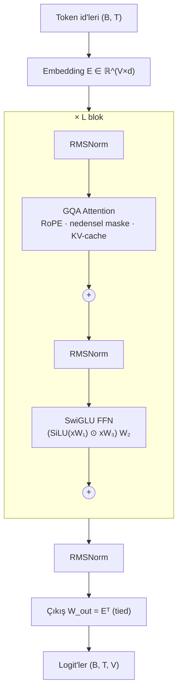

<div align="center">

# KökLM

**Milyar parametrelik LLM'leri kökünden çözmek için sıfırdan yazdığım dil modeli.**

*A from-scratch, Llama 3–compatible language model in PyTorch, built to understand billion-parameter LLMs from first principles.*

[](https://mkor4y.github.io/koklm/)
[](https://github.com/mkor4y/koklm/actions/workflows/ci.yml)
[](LICENSE)


### [🌐 Etkileşimli siteyi aç → mkor4y.github.io/koklm](https://mkor4y.github.io/koklm/)

[](https://colab.research.google.com/github/mkor4y/koklm/blob/main/notebooks/KokLM_Llama.ipynb) &nbsp;Gerçek Llama 3.2 ağırlıklarıyla KökLM'i çalıştır ve sohbet et

</div>

---

KökLM, büyük dil modellerini kara kutu olmaktan çıkarmak için yazıldı. Her bileşen, arkasındaki
matematikle birlikte sıfırdan yazıldı ve [`docs/matematik.md`](docs/matematik.md) içinde türetildi.
Mimari, Meta'nın açık kaynak **Llama 3** ailesiyle birebir uyumlu: gerçek Llama 3.2 1B ağırlıkları
KökLM'e yüklenip çalıştırılabilir ve Hugging Face uygulamasıyla aynı çıktıyı verdiği testlerle doğrulanır.

## Etkileşimli site

**[https://mkor4y.github.io/koklm/](https://mkor4y.github.io/koklm/)**

Projenin tamamı tarayıcıda, kurulum gerektirmeden incelenebilir:

- Sürüklenip döndürülebilen **3B transformer yığını**; bir bloğa tıklayınca içi açılır
- Bir token'ın modeldeki **yolculuğu**: her durağın denklemi, örnek hesabı ve gerçek kodu
- Bir bloğun **matris matris anatomisi** ve **canlı parametre hesaplayıcı** (1B / 8B)
- **Kendi cümlenle attention**: RoPE, nedensel maske ve √dh'nin etkisi
- **KV-cache**, **eğitim döngüsü** ve **GPU belleği** görselleştirmeleri
- Tarayıcıda canlı çalışan **BPE tokenizer** ve **kod gezgini**

Sitenin kaynağı [`docs/`](docs/) klasöründedir.

## Öne çıkanlar

- **Llama 3 mimarisi:** RMSNorm (pre-norm) · RoPE + Llama 3.1 uzun bağlam ölçeklemesi · Grouped-Query Attention · SwiGLU · paylaşımlı embedding
- **Gerçek ağırlıklar:** Meta orijinal ve Hugging Face formatlarından yükleme; HF Llama ile **aynı logit'ler** (test edildi)
- **GPU'ya hazır:** FlashAttention (SDPA), bf16, KV-cache, `torch.compile`, çoklu GPU (DDP), gradient checkpointing
- **Sıfırdan BPE tokenizer:** saf Python, Türkçe karakterlerle test edildi
- **Milyar parametre analizi:** 1B ve 8B modelleri formülle ve bellek ayırmadan (`meta` cihaz) kalem kalem sayma, FLOP ve bellek kestirimi

## Mimari



## Model ayarları

| Ayar | Parametre | d | L | H / Hkv | FFN | Referans |
|---|---:|---:|---:|---:|---:|---|
| `kucuk` | 2 885 888 | 256 | 4 | 8 / 2 | 704 | tek GPU, dakikalar |
| `1B` | **1 235 814 400** | 2048 | 16 | 32 / 8 | 8192 | Llama 3.2 1B |
| `8B` | **8 030 261 248** | 4096 | 32 | 32 / 8 | 14336 | Llama 3 8B |

```text
$ python scripts/parametre_say.py 1B
Tek blok:
  Wq  (d x d)                   4,194,304  (  6.9%)
  Wk  (d x Hkv*dh)              1,048,576  (  1.7%)
  Wv  (d x Hkv*dh)              1,048,576  (  1.7%)
  Wo  (d x d)                   4,194,304  (  6.9%)
  W1 gate (d x f)              16,777,216  ( 27.6%)
  W3 up   (d x f)              16,777,216  ( 27.6%)
  W2 down (f x d)              16,777,216  ( 27.6%)
  ...
  TOPLAM                    1,235,814,400  ≈ 1.24 milyar
```

## Kurulum

```bash
git clone https://github.com/mkor4y/koklm && cd koklm
pip install -e ".[dev]"          # gerçek Llama ağırlıkları için: pip install -e ".[dev,hf]"
pytest
```

## Kullanım

### Llama ağırlıklarıyla çalıştır ve sohbet et

KökLM'in mimarisi Llama 3 ile birebir aynı olduğu için Meta'nın eğittiği ağırlıklar doğrudan yüklenebilir.
En kolay yol: [Colab not defteri](https://colab.research.google.com/github/mkor4y/koklm/blob/main/notebooks/KokLM_Llama.ipynb) (ücretsiz T4 GPU yeterli).

```bash
pip install -e ".[hf]"
huggingface-cli login          # model sayfasında Meta'nın lisansını kabul etmiş olmalısın

# 1) Llama ağırlıklarını KökLM checkpoint'ine dönüştür, HF Llama ile karşılaştır
python scripts/llama_donustur.py --hf meta-llama/Llama-3.2-1B-Instruct \
    --cikti checkpoints/llama32_1b_instruct.pt --dogrula

# 2) Sohbet et
python scripts/generate.py --ckpt checkpoints/llama32_1b_instruct.pt --sohbet

# 3) Llama'dan başlayarak kendi Türkçe verinle ince ayar yap
python scripts/prepare_data.py --girdi metinler/ --cikti data/tr \
    --tokenizer hf:meta-llama/Llama-3.2-1B-Instruct
python scripts/train.py --baslangic checkpoints/llama32_1b_instruct.pt --data data/tr \
    --lr 2e-5 --min_lr 2e-6 --warmup 50 --max_steps 1000 --grad_checkpoint
```

Llama ağırlıkları bu repoda yer almaz; Meta'nın [Llama 3.2 lisansına](https://www.llama.com/llama3_2/license/) tabidir.

### Kendi modelini eğit

```bash
# 1) Tokenizer (isteğe bağlı; yoksa --tokenizer byte)
python scripts/train_bpe.py --girdi metinler/ --vocab_size 8192 --cikti tokenizer.json

# 2) Veri
python scripts/prepare_data.py --girdi metinler/ --cikti data/tr --tokenizer bpe:tokenizer.json

# 3) Eğitim — tek GPU
python scripts/train.py --model kucuk --data data/tr

#    Eğitim — 8 GPU, 1B
torchrun --standalone --nproc_per_node=8 scripts/train.py --model 1B --data data/tr \
    --seq_len 2048 --batch_size 8 --grad_accum 8 --compile --grad_checkpoint

# 4) Üretim
python scripts/generate.py --ckpt checkpoints/en_iyi.pt --prompt "Bir varmış bir yokmuş"
```

Eğitim; AdamW (β = 0.9, 0.95), ısınma + kosinüs öğrenme oranı, gradyan kırpma, gradyan biriktirme,
bf16 autocast ve kaldığı yerden devam etmeyi destekler. Metrikler `checkpoints/log.jsonl`'a yazılır.

### Python'dan

```python
import torch
from koklm import Transformer, AYARLAR

model = Transformer(AYARLAR["kucuk"])
logits, loss = model(tokens, targets)            # eğitim
out = model.generate(prompt, max_new_tokens=50)  # KV-cache ile üretim

with torch.device("meta"):                       # 8B'yi bellek ayırmadan kur
    print(Transformer(AYARLAR["8B"]).parametre_sayisi())   # 8030261248
```

## Donanım kestirimi

| | `kucuk` | `1B` | `8B` |
|---|---:|---:|---:|
| Ağırlıklar (bf16) | 6 MB | 2,3 GiB | 15 GiB |
| AdamW ile eğitim (~16 B/param, aktivasyon hariç) | 46 MB | ~18 GiB | ~120 GiB |
| KV-cache (bf16) | 0,5 MiB (512 bağlam) | 256 MiB (8K bağlam) | 1 GiB (8K bağlam) |
| Uygun donanım | herhangi bir GPU/CPU | 1× A100 80GB veya üstü | çoklu A100/H100 (FSDP, yol haritasında) |

## Proje yapısı

```text
koklm/
  config.py        hiperparametreler, Llama FFN formülü, hazır ayarlar
  model.py         RMSNorm, RoPE, GQA attention, SwiGLU, Transformer, KV-cache, üretim
  bpe.py           sıfırdan byte seviyesi BPE tokenizer
  tokenizer.py     byte / BPE / Hugging Face tokenizer seçimi
  yukle.py         Meta ve Hugging Face Llama ağırlıklarını yükleme
  analiz.py        parametre, FLOP ve bellek analizi
scripts/
  train.py  generate.py  prepare_data.py  train_bpe.py  parametre_say.py
docs/matematik.md  her bileşenin denklemleri ve türetimleri
tests/             mimari, nedensellik, KV-cache, RoPE, BPE, HF Llama uyumluluğu
```

## Testler

| Test | Neyi kanıtlıyor |
|---|---|
| `test_hf_llama_ile_ayni_logit` | Aynı ağırlıklarla Hugging Face Llama'sıyla aynı çıktı |
| `test_milyar_parametre_meta_cihazda` | 1B ve 8B parametre sayıları Meta'nınkiyle birebir |
| `test_kv_cache_ayni_sonuc` | Adım adım üretim = tüm diziyi tek seferde işlemek |
| `test_nedensellik` | Model geleceğe bakmıyor |
| `test_rope_goreli_konum` | RoPE skoru yalnızca göreli konuma bağlı |
| `test_gidis_donus_ve_sikistirma` | BPE kayıpsız ve metni sıkıştırıyor |

## Yol haritası

- [x] Llama 3 mimarisi ve matematik dokümanı
- [x] Eğitim, veri ve üretim altyapısı
- [x] Gerçek Llama 3 ağırlıklarını yükleme ve doğrulama
- [x] Sıfırdan BPE tokenizer
- [x] Llama ağırlıklarıyla sohbet ve ince ayar başlangıcı
- [ ] FSDP ile 8B ölçeğinde eğitim
- [ ] Türkçe ön-eğitim ve ölçekleme deneyleri
- [ ] Sohbet ince ayarı (SFT) ve LoRA
- [ ] int8 / int4 nicemleme

## Atıf

Mimari, Meta'nın açık kaynak [Llama 3](https://github.com/meta-llama/llama-models) modellerinden
esinlenmiştir. KökLM Meta'nın kodunu içermez; Llama ağırlıklarını kullanmak, Llama lisansına tabidir.

Bu çalışmayı kullanırsanız: [`CITATION.cff`](CITATION.cff)

## Lisans

[MIT](LICENSE) © 2026 Mustafa Koray KÖK
